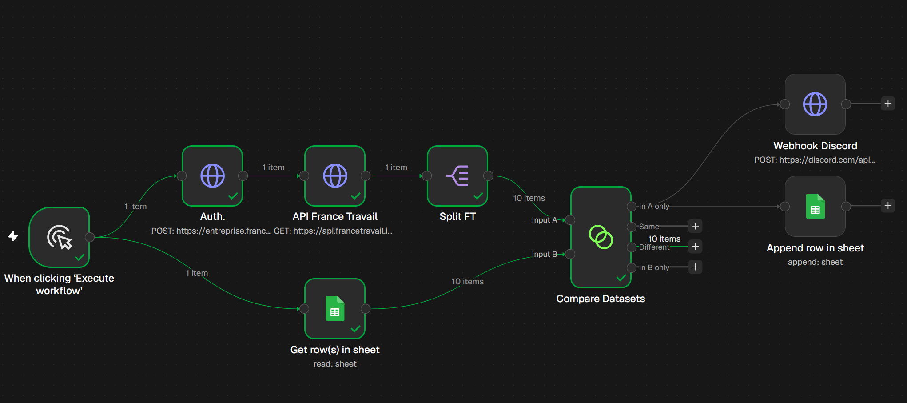
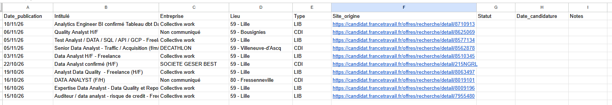

# Recherche d'emploi automatisée avec n8n

## Workflow n8n :
N8N est un outli d'automatisation qui permet de relier plusieurs services entre-eux. Je m'en suis servi pour appeler l'API de France Travail afin de récolter des offres d'emploi (de data analyst) et de les répertorier dans un fichier Google Sheets afin de suivre les candidatures. Il y a aussi un Webhook Discord pour envoyer une notif à chaque nouvelle offre d'emploi trouvée.

### Screenshot n8n :

### Screenshot Sheets :

### Screenshot Discord :
